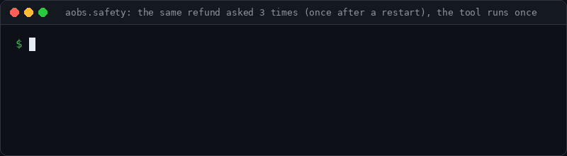

# aobs — observability and action safety for AI agents

[](https://github.com/AshmitJain932/ai-agent-observability/actions/workflows/ci.yml)
[](LICENSE)


**See what your agent did, catch regressions in CI, and stop it from doing the same risky thing twice.**



*Real output of [`examples/support_agent/protect_example.py`](examples/support_agent/protect_example.py):
the customer asks for the same refund three times (the last time after a restart) and the refund
tool runs once.*

- **Trace every run.** Model calls, tool calls, sub-agents, errors, latency and tokens as nested
  traces. A standard-library-only Python SDK, with integrations for OpenAI-compatible clients,
  Anthropic and LangChain / LangGraph, and export to OpenTelemetry backends.
- **Explain and compare runs.** Deterministic diagnosis (errors, retry storms, wasted calls,
  bottlenecks) with evidence, regression detection between runs, and statistics over repeated runs.
- **Gate agents in CI.** Write requirements in a TOML policy; the gate answers PASS or FAIL with the
  spans that prove it, writes JUnit and Markdown reports, and ships as a
  [GitHub Action](docs/github-action.md).
- **Guard risky actions.** [`aobs.safety`](docs/action-safety.md) checks refunds, emails, deletes
  and deploys against trusted evidence before they run, asks for approval above a threshold, and
  prevents duplicates across retries and restarts. It is not exactly-once; its guarantees are
  stated.

> **Status: alpha** (`0.1.0.dev0`), not on PyPI yet: install from a clone. Not production-hardened:
> the collector has no rate limiting, retention job or TLS of its own. Integrations are tested
> against the real client libraries with mocked HTTP, not yet against live provider APIs.

## See it in 60 seconds

With Docker, from a clone of this repository:

```bash
docker compose up
```

Open <http://localhost:8800/#token=aobs-demo-token> and choose **Stored traces**: PostgreSQL, the
collector and the dashboard are running locally with 73 sample runs. The credentials are demo
values for your own machine only; see [docs/docker.md](docs/docker.md).

## Quick start: your own agent

Requires Python ≥ 3.11.

```bash
git clone https://github.com/AshmitJain932/ai-agent-observability.git
pip install ./ai-agent-observability/sdk/python ./ai-agent-observability/server
```

Record what your agent does (`agent.py`; the SDK has no dependencies, and nothing leaves your
machine with a file exporter):

```python
import aobs
from aobs.export import JsonlFileExporter

aobs.init(service_name="my-agent", exporter=JsonlFileExporter("traces.jsonl"))


@aobs.tool
def lookup_order(order_id: str) -> dict:
    return {"order_id": order_id, "status": "delivered"}


with aobs.run("answer_ticket", session_id="ticket-1"):
    lookup_order("1042")  # model calls: wrap your client, see "Integrations" below

aobs.shutdown()
```

Explain the run:

```bash
python agent.py
aobs-server analyze traces.jsonl
```

Then write down what a good run looks like, `policy.toml`:

```toml
version = 1

[gate]
task = "answer_ticket"           # check runs whose root span has this name

[run]
require_success = true
require_complete = true          # every span ended
max_duration_ms = 10000
max_tool_calls = 4
required_tools = ["lookup_order"]
```

and check the run against it (exit code 0 on PASS, 3 on FAIL, so CI can block a regression):

```bash
aobs-server gate --policy policy.toml traces.jsonl
```

Next: [docs/getting-started.md](docs/getting-started.md), the [SDK guide](docs/sdk.md), the
[reliability gate](docs/reliability-gate.md) and [action safety](docs/action-safety.md).

## Integrations

| | How | Docs |
|---|---|---|
| OpenAI and OpenAI-compatible Chat Completions (sync, async, streaming) | `aobs.integrations.openai_compat.wrap(client)` | [sdk.md](docs/sdk.md) |
| Anthropic Messages API (sync, async, streaming, `messages.stream`) | `aobs.integrations.anthropic.wrap(client)` | [integrations/anthropic.md](docs/integrations/anthropic.md) |
| LangChain / LangGraph (graphs, nodes, chat models, tools, retrievers) | `config={"callbacks": [aobs.integrations.langchain.CallbackHandler()]}` | [integrations/langchain.md](docs/integrations/langchain.md) |
| OpenTelemetry backends (Jaeger, Tempo, Honeycomb, Datadog via the Collector) | `aobs.export.OtlpHttpExporter(...)` | [opentelemetry.md](docs/opentelemetry.md) |
| Any language | `POST /v1/ingest` on the collector | [ingestion.md](docs/ingestion.md) |
| GitHub Actions | `uses: AshmitJain932/ai-agent-observability/actions/gate@<commit-sha>` | [github-action.md](docs/github-action.md) |

Tested with the real client libraries (`openai` 3.29.0, `anthropic` 2.1.0, `langchain-core` 1.6.13,
`langgraph` 1.2.16) against mocked HTTP or fake models, and OTLP payloads checked with
`opentelemetry-proto`. Opt-in live tests against the real provider APIs exist
([docs/sdk.md](docs/sdk.md#live-smoke-tests)) but are not run by CI.

## Guard a risky tool

Wrap the existing tool; the tool and the agent loop do not change. Evidence comes from your system
of record, not from the model:

```python
from aobs import safety

guard = safety.ActionGuard(
    safety.load_policy("safety_policy.toml"),
    store=safety.SqliteActionStore("actions.db", secret=STORE_SECRET),
    idempotency=safety.IdempotencyKeys(namespace="support-agent", secret=IDEMPOTENCY_SECRET),
)
issue_refund = guard.protect(
    issue_refund,                                          # your existing tool
    action="issue_refund",
    evidence=lambda: orders.get_status(ticket.order_id),  # trusted record
    action_key=f"refund:{ticket.id}",                     # one refund per ticket
)
```

Recipes with runnable, offline examples: [refunds](examples/support_agent/protect_example.py),
[emails, record deletion and deploys](examples/safety_recipes/README.md). Guarantees and limits:
[docs/action-safety.md](docs/action-safety.md).

## What works today

| Component | Location | Status |
|---|---|---|
| Wire schema v1.0 (normative JSON Schema) + 57 conformance fixtures | `schema/` | Done |
| Strict parsing, validation, version policy, merge, trace assembly | `server/src/aobs_server/model/` | Done (library only) |
| Python SDK `aobs` (stdlib only) | `sdk/python/` | Done — see [docs/sdk.md](docs/sdk.md) |
| OpenAI-compatible integration (sync/async/streaming) | `aobs.integrations.openai_compat` | Done — tested with `openai` 3.29.0 |
| Anthropic Messages API integration (sync/async/streaming) | `aobs.integrations.anthropic`, [docs](docs/integrations/anthropic.md) | First version — tested with `anthropic` 2.1.0 over mocked HTTP |
| LangChain / LangGraph callback handler | `aobs.integrations.langchain`, [docs](docs/integrations/langchain.md), [example](examples/langgraph_agent/README.md) | First version — tested with `langchain-core` 1.6.13 and `langgraph` 1.2.16, fake models |
| OpenTelemetry export (OTLP/HTTP JSON, GenAI conventions) and fan-out to several exporters | `aobs.export.OtlpHttpExporter`, `FanOutExporter`, [docs](docs/opentelemetry.md) | First version — payloads checked with `opentelemetry-proto`; not run against a live backend |
| Example tool-calling agent, mock and live modes | `examples/support_agent/` | Done |
| Overhead benchmark + recorded baseline | `sdk/python/benchmarks/`, [docs/benchmarks.md](docs/benchmarks.md) | Done |
| Offline trace diagnosis (`aobs-server analyze`): deterministic rules, evidence, suggestions | `server/src/aobs_server/diagnosis/`, [examples/diagnose](examples/diagnose/README.md) | Demo (no server or database needed) |
| Cross-run regression detection (`aobs-server compare`): new failures, slowdowns, retries, tool/model/token/cost changes | `server/src/aobs_server/diagnosis/compare.py`, [examples/diagnose](examples/diagnose/README.md#demo-compare-runs-and-find-regressions) | Demo (no server or database needed) |
| Web dashboard (`aobs-server dashboard`): overview, runs explorer, run details with diagnosis, two-run and group comparison, over sample data, local trace files or a project's stored traces | `server/src/aobs_server/dashboard/`, [docs/dashboard.md](docs/dashboard.md) | First version |
| Repeated-run regression analysis (`aobs-server compare-groups`): medians, variation, exact rank / Fisher tests with Holm correction, honest "insufficient data" | `server/src/aobs_server/diagnosis/repeated.py`, `stats.py`, [examples/diagnose](examples/diagnose/README.md#demo-repeated-runs-with-statistics) | Demo (no server or database needed) |
| Reliability gate (`aobs-server gate`): requirements in a TOML policy (outcome, completeness, duration, calls, retries, tokens, cost, tools, pass rate, baseline limits) → PASS/FAIL with evidence, exit code 3 on FAIL; JUnit XML and Markdown reports for CI (`--junit`, `--markdown`), GitHub Actions template | `server/src/aobs_server/diagnosis/gate.py`, [docs/reliability-gate.md](docs/reliability-gate.md) | First version (no server or database needed) |
| Reliability gate GitHub Action: job summary, JUnit, optional sticky PR comment | `actions/gate/`, [docs/github-action.md](docs/github-action.md) | First version — self-tested on every change |
| Server foundations: PostgreSQL schema + migrations, API keys, authorization, ingest privacy step | `server/src/aobs_server/` | Done (Phase 3) |
| Ingestion API (`aobs-server serve`, `POST /v1/ingest`): API-key auth, privacy before storage, retry-safe idempotent merge, per-trace locking, trace summaries | `server/src/aobs_server/api/`, `ingest/`, `storage/traces.py`, [docs/ingestion.md](docs/ingestion.md) | First version (Phase 3; no rate limiting or retention job yet) |
| Trace read API (`GET /v1/projects/{id}/traces/{trace_id}`, `…/events`): read-scoped keys, uniform 404 across projects, content opt-in under the project's current privacy settings, pagination | `server/src/aobs_server/query/`, [docs/traces-api.md](docs/traces-api.md) | First version (Phase 3; no run list or search yet) |
| Analysis of stored traces: `db:` selections for `analyze`, `compare`, `compare-groups`, `gate`; `traces list`; a *Stored traces* dashboard dataset (`--project`) | `server/src/aobs_server/diagnosis/stored.py`, [docs/stored-analysis.md](docs/stored-analysis.md) | First version (CLI and dashboard read PostgreSQL directly) |
| Action safety (`aobs.safety`): policy checks against trusted evidence before a side effect, approval, duplicate prevention, durable SQLite store, recovery without blind retries, provider idempotency keys | `sdk/python/src/aobs/safety.py`, [docs/action-safety.md](docs/action-safety.md) | First version (one host; not exactly-once: see its guarantees) |
| Action-safety recipes: emails, record deletion, deploys | [examples/safety_recipes](examples/safety_recipes/README.md) | Offline examples with tests |
| One-command local demo (`docker compose up`): PostgreSQL, collector, dashboard, 73 sample runs | `Dockerfile`, `compose.yaml`, [docs/docker.md](docs/docker.md) | First version — built and started by CI on every change |
| HTTP query API (run list, search, analysis over read-scoped keys) | — | Phase 4 |


## Try it

Requires [uv](https://docs.astral.sh/uv/) and Python ≥ 3.11.

```bash
uv sync
uv run python examples/support_agent/run.py --scenario refund-outage    # no API key needed
```

**Collector:** store runs in PostgreSQL with `uv run aobs-server serve` and an API key; see
[docs/ingestion.md](docs/ingestion.md).

**The whole workflow, end to end:** [docs/agent-workflow.md](docs/agent-workflow.md). Run the
example agent (scripted mock model, no API key) and send its runs to the collector. Then list,
analyze and compare the stored runs, gate them (the healthy run passes; the refund outage is
rejected with the failing span as evidence), and view them in the dashboard.

**Dashboard:** `uv run aobs-server dashboard`, then open <http://localhost:8800/> (in a Codespace:
Ports tab → port 8800 → *Open in Browser*). It starts with clearly labelled sample data; see
[docs/dashboard.md](docs/dashboard.md).

The example command above prints the agent's answer, then the trace the collector will reconstruct (validated with the
Phase 1 model library). See [examples/support_agent/README.md](examples/support_agent/README.md).

Diagnose a recorded run (errors, repeated failures, wasted calls, bottlenecks, with evidence and
suggestions; content is never shown):

```bash
uv run aobs-server analyze examples/diagnose/traces/retry_storm.jsonl
```

Compare a baseline run with a later one (what got slower, what newly fails, what costs more):

```bash
uv run aobs-server compare examples/diagnose/compare/inventory_v1.jsonl examples/diagnose/compare/inventory_v2.jsonl
```

With several recordings per side, test whether the change is beyond normal run-to-run variation:

```bash
uv run aobs-server compare-groups --baseline examples/diagnose/groups/baseline.jsonl --current examples/diagnose/groups/slow.jsonl
```

See [examples/diagnose/README.md](examples/diagnose/README.md).

Check recorded runs against written requirements, e.g. in CI (exit code 3 on FAIL, every failure
explained with the spans that show it):

```bash
uv run aobs-server gate --policy examples/diagnose/gate/support_agent.toml examples/diagnose/compare/refund_outage.jsonl
```

See [docs/reliability-gate.md](docs/reliability-gate.md).

### Reliability gate demo (no API key, no database)

Record a healthy and a degraded run of the example support agent with the real SDK (a scripted
model stands in for the LLM; the refund tool times out in the degraded run), then gate both:

```bash
uv run python examples/diagnose/make_compare_samples.py --out /tmp/aobs-gate-demo
uv run aobs-server gate --policy examples/diagnose/gate/support_agent.toml /tmp/aobs-gate-demo/refund_ok.jsonl
echo "exit code: $?"   # 0: PASS
uv run aobs-server gate --policy examples/diagnose/gate/support_agent.toml /tmp/aobs-gate-demo/refund_outage.jsonl
echo "exit code: $?"   # 3: FAIL
```

The second report fails two checks and shows each one's expected and actual value:

```
FAIL     run.require_success: the run ended with status error  [expected ok or ok_with_errors, actual error]
           - root cause: tool 'issue_refund' failed with TimeoutError; span … (tool issue_refund) ended with status error …
FAIL     run.tools.issue_refund.max_failures: 1 failure(s) of 'issue_refund', limit 0  [expected at most 0, actual 1]
```

`server/tests/test_gate.py::test_readme_demo_records_fresh_runs_with_the_sdk_and_gates_them` runs
the same steps.

**In CI**, add `--junit reports/agent-gate.xml --markdown "$GITHUB_STEP_SUMMARY"`. The JUnit file
is a test report (one test case per check) for GitLab, Jenkins, Azure DevOps and others; the
Markdown file is the GitHub Actions job summary. A complete GitHub Actions workflow to copy:
[examples/ci/github-actions-agent-gate.yml](examples/ci/github-actions-agent-gate.yml). Details:
[docs/reliability-gate.md#in-ci](docs/reliability-gate.md#in-ci).

### Analyze traces stored by the collector (PostgreSQL)

Every analysis command also reads the traces the collector stored. Set `AOBS_DATABASE_URL`, name
the project, and select traces with `db:` instead of a file (setup: [docs/ingestion.md](docs/ingestion.md#quick-start)):

```bash
uv run aobs-server traces list --project <project_id>                       # newest first, with db:trace=<id> inputs
uv run aobs-server analyze --project <project_id> db:trace=<trace_id>
uv run aobs-server compare --project <project_id> db:trace=<baseline_id> db:trace=<current_id>
uv run aobs-server compare-groups --project <project_id> \
  --baseline 'db:task=restock_check&until=2026-10-08' --current 'db:task=restock_check&since=2026-10-13'
uv run aobs-server gate --project <project_id> --policy examples/diagnose/gate/support_agent.toml \
  'db:task=answer_ticket&since=2026-10-13'
uv run aobs-server dashboard --project <project_id>                         # adds a token-protected "Stored traces" dataset
```

Selections, isolation, privacy, exit codes and limits: [docs/stored-analysis.md](docs/stored-analysis.md).

## Development

Setup, the exact checks CI runs, conventions and the safety rules for contributions:
[CONTRIBUTING.md](CONTRIBUTING.md). In short:

```bash
uv sync --locked
uv run ruff check . && uv run ruff format --check sdk server examples schema
uv run mypy --strict sdk/python/src server/src
uv run python -m aobs_server.model.schema_lock  # schema file matches its lock
uv run pytest -q                                 # everything: SDK + server (~5 min)
uv run --group docs mkdocs build --strict        # the documentation site
```

## Documentation

All guides live in [`docs/`](docs/index.md) and build into a documentation site with MkDocs
(`mkdocs.yml`).

| Doc | Contents |
|---|---|
| [docs/getting-started.md](docs/getting-started.md) | **Start here:** instrument your own agent, then explain and gate its runs |
| [docs/agent-workflow.md](docs/agent-workflow.md) | The example agent end to end: run it, send its runs to the collector, then list, analyze, compare, gate them and view them in the dashboard (no model API key needed) |
| [docs/docker.md](docs/docker.md) | The one-command local demo: start, open, send your own traces, reset |
| [docs/sdk.md](docs/sdk.md) | SDK usage, configuration, privacy, delivery guarantees, exporters, integrations, live smoke tests, limitations |
| [docs/integrations/anthropic.md](docs/integrations/anthropic.md), [docs/integrations/langchain.md](docs/integrations/langchain.md) | Provider and framework integrations: what is recorded, usage rules, limits |
| [docs/opentelemetry.md](docs/opentelemetry.md) | Sending traces to OpenTelemetry backends: setup, attribute mapping, delivery, limits |
| [docs/action-safety.md](docs/action-safety.md) | Guarding side effects: policy, evidence, approval, duplicates, recovery, guarantees and limits |
| [docs/reliability-gate.md](docs/reliability-gate.md) | Reliability gate: policy file, checks, missing-data rules, exit codes, CI use, limits |
| [docs/github-action.md](docs/github-action.md) | The gate as a GitHub Action: inputs, outputs, permissions, untrusted-data handling |
| [docs/stored-analysis.md](docs/stored-analysis.md) | Analyzing stored traces: `db:` selections, `traces list`, analyze/compare/compare-groups/gate and the dashboard over PostgreSQL |
| [docs/dashboard.md](docs/dashboard.md) | Web dashboard: start, use, local files mode, security, limits |
| [docs/ingestion.md](docs/ingestion.md) | Collector: PostgreSQL setup, API keys, `POST /v1/ingest` request/response, limits, duplicates, retries, errors |
| [docs/traces-api.md](docs/traces-api.md) | Reading a stored trace and its span events: endpoints, pagination, tenant isolation, privacy |
| [docs/event-model.md](docs/event-model.md) | Normative event semantics: fields, unknown-value rules, merge, derived state, versioning |
| [docs/architecture.md](docs/architecture.md), [docs/decisions.md](docs/decisions.md) | System shape, stack and the decisions behind them |
| [docs/roadmap.md](docs/roadmap.md) | Phases with acceptance criteria and status |
| [docs/benchmarks.md](docs/benchmarks.md) | Overhead method and recorded baseline |
| [CHANGELOG.md](CHANGELOG.md), [schema/CHANGELOG.md](schema/CHANGELOG.md) | Project and wire-schema changes |

## Support matrix (honest)

| Integration | Status |
|---|---|
| Manual instrumentation (Python ≥ 3.11) | Supported |
| OpenAI-compatible Chat Completions client (Python) | Supported; tested with `openai` 3.29.0 |
| Anthropic Messages API client (Python) | First version; tested with `anthropic` 2.1.0 over mocked HTTP |
| LangChain / LangGraph (Python) | First version; tested with `langchain-core` 1.6.13 and `langgraph` 1.2.16 with fake models |
| OpenTelemetry export (OTLP/HTTP JSON) | First version; payloads validated with `opentelemetry-proto`, not run against a live backend |
| HTTP ingestion API (any language) | First version — `POST /v1/ingest`, see [docs/ingestion.md](docs/ingestion.md) |
| OpenTelemetry GenAI (OTLP) ingestion into the collector | Planned — Phase 7 |
| Everything else | Not supported |

## Contributing and security

Contributions are welcome: see [CONTRIBUTING.md](CONTRIBUTING.md) and the
[code of conduct](CODE_OF_CONDUCT.md). Please report vulnerabilities privately as described in
[SECURITY.md](SECURITY.md), not in a public issue.

## License

Apache License 2.0: see [LICENSE](LICENSE).
